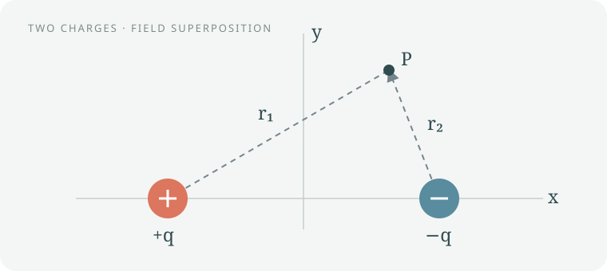

# 第二章：双电荷与电偶极矩

这里引用第一章的 @{1.1} 和 @def{1.1}。从第三章跳来后，可以继续点击这两个引用，再使用浮标逐次返回。

## 双电荷示意

@#fig{2.1} 两个异号电荷及观察点

这里的相对图片路径以第二章为准；在第三章预览 @fig{2.1} 时也应正常显示。

## 电偶极矩

对相距 $\mathbf d$ 的等量异号电荷，$\mathbf d$ 从负电荷指向正电荷：

$$
\mathbf p=q\mathbf d \tag{2.1}
$$

## 重号演示

$$
x_{\text{第二章}}=2 \tag{A.1}
$$

## Ctrl+Alt 图注标记练习

下面的图片故意还没有插件目标标记。按住 Ctrl+Alt，只拖选图注行开头的“图2.2”，保持两个键按下并松开鼠标；应得到 `@#fig{2.2}`，后面的说明保持不变。Ctrl+Z 可一步撤销。

图2.2 保留这段图片说明

完成后，此处的 @fig{2.2} 就能预览上面的图片。普通 Alt 拖选用于转换正文引用，仍然生成 `@fig{2.2}`。
